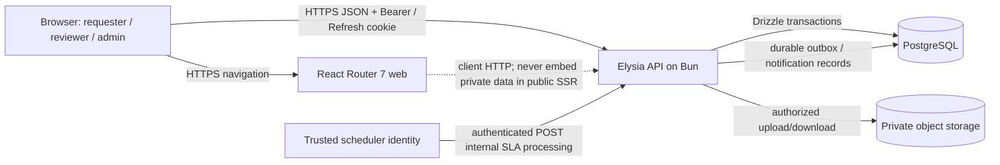
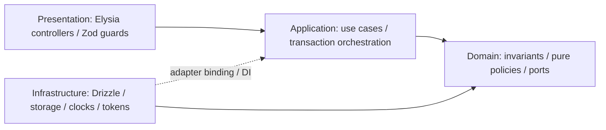
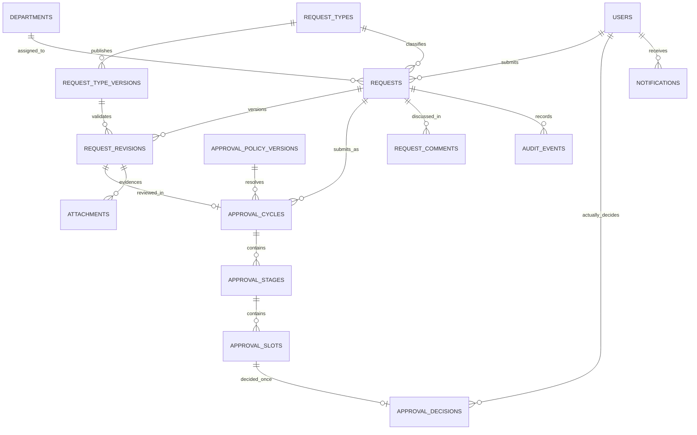
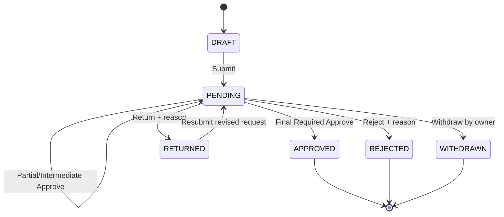
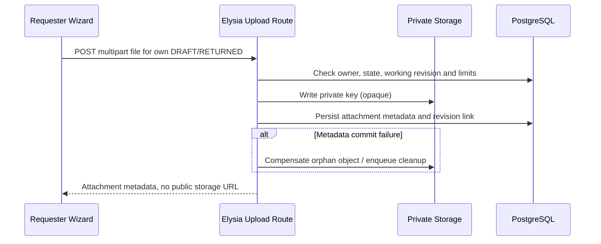

# CPE334 Theme 5 — System-Level Software Design Specification (SDS)

**Document:** `system-sds.md`  
**Document version:** 1.0.0 — proposed implementation design against frozen requirements  
**Status:** Design baseline; **physical schema and internal implementation choices are proposed, not additional frozen product requirements**  
**Product authority:** [`specifications.md`](./specifications.md) and [`srs.md`](./srs.md)  
**Wire authority:** [`api-specs.md`](./api-specs.md) v1.0.1  
**Interaction authority:** [`ui-specs.md`](./ui-specs.md) v1.0  
**Verification:** [`test.md`](./test.md) and [`traceability.md`](./traceability.md)

> **Design-source discipline:** This design implements the approved 54 features and 15 product decisions without expanding scope. **[FROZEN]** marks behavior fixed by source contracts. **[PROPOSED DESIGN]** marks an engineering choice that needs code/design review, not a new user decision. If a proposed table, endpoint interpretation or component structure conflicts with frozen behavior, the frozen source contract wins. No feature is claimed implemented or tested.

## 1. Purpose, Goals and Boundary

### 1.1 Architectural objectives

- Build one reliable, traceable Requester → Reviewer → Decision system, then extend it with configuration, multi-stage approval and operations.
- Use a single authoritative approval engine for individual, bulk, sequential, parallel, reassigned and delegated decisions.
- Keep all authoritative state, money, access and version rules on the backend.
- Separate type-version pinning from policy-version resolution on resubmission.
- Keep a narrow, privacy-safe administrative surface; role membership alone is insufficient to read private requests.
- Provide test seams for deterministic clocks, transactions, recovery-code generation, storage and scheduled processing.

### 1.2 Explicit boundaries

**In:** frozen 54 selected features, private file storage, persistent jobs and notifications, 1 organization/multiple departments, 2 maximum sequential stages, parallel ALL, policy-based monetary limits.  
**Out:** OAuth, tenant isolation, visual workflow designer, arbitrary field scripts, budget balance ledger, payment/settlement, email reset and notifications, holiday calendar, auto-reassignment and auto-approval.

## 2. Context, Containers and Trust Zones



**Trust rules:** Browser and frontend presentation are untrusted for authorization. Elysia verifies the actual viewer, active sessions, permissions, current approval task and authoritative form/policy versions. Storage and job endpoints cannot be reached using a caller-supplied `isAdmin` flag. Public SSR never serializes session-derived private request objects.

### 2.1 Proposed deployment units

| Unit                     | Responsibilities                                                              | Persistence and secrets                                                               |
| ------------------------ | ----------------------------------------------------------------------------- | ------------------------------------------------------------------------------------- |
| `apps/web`               | Public SSR, hydration, SPA navigation and authenticated client-loaded screens | No durable business state or raw refresh token access                                 |
| `apps/api`               | API routes, use cases, policy engine, uploads, authorized reads               | Database credentials, signing keys, storage and trusted-job configuration via secrets |
| PostgreSQL               | Source of truth, constraints, transaction locks, idempotency, audits/outbox   | Durable volume/managed DB with backups                                                |
| Private object storage   | Supporting files                                                              | Private bucket/container; opaque keys, no public listing                              |
| Trusted scheduled caller | Calls `/internal/jobs/sla-process`                                            | Machine identity and retry-safe schedule                                              |

**[PROPOSED DESIGN]** Separate web/API deployments can share one public origin via a reverse proxy to simplify cookie/origin defenses. This deployment preference is adjustable; cross-origin deployment must implement the exact frozen CORS and session safeguards.

## 3. Monorepo and Dependency Direction

```text
workflow-approval-system/
├── AGENTS.md                         # only root AI-instruction file
├── apps/
│   ├── web/
│   │   ├── .env.example
│   │   └── app/
│   │       ├── routes.ts
│   │       ├── routes/                  # thin React Router adapters
│   │       ├── modules/                 # domain-oriented feature slices
│   │       ├── components/              # shared DataTable / Form / AppShell / Status
│   │       ├── api/                     # typed client and auth-refresh behavior
│   │       └── app.css                  # Tailwind imports and theme tokens ONLY
│   └── api/
│       ├── .env.example
│       └── src/
│           ├── Domains/
│           ├── Applications/
│           ├── Infrastructures/
│           └── Presentations/
├── packages/
│   └── contracts/                      # Zod static transport contracts / types
├── docs/
│   ├── specifications.md
│   ├── api-specs.md
│   ├── ui-specs.md
│   ├── test.md
│   ├── srs.md
│   ├── system-sds.md
│   └── traceability.md
├── package.json
└── bun.lock
```

**[FROZEN]** Bun Workspaces, one root `AGENTS.md`, React Router 7 Framework Mode with `ssr:true`, shadcn/ui, Tailwind-only styling, Elysia + Bun, OOP/Clean Architecture, PostgreSQL/Drizzle and a single Zod contracts package. Web and API have separate environment configurations; neither commits real credentials.

### 3.1 Clean Architecture dependency rule



- **Domain** owns `Request`, `ApprovalCycle`, `ApprovalSlot`, `RequestDefinition`, policy matching, state transition and role/resource invariants. No SQL, Elysia or browser dependencies.
- **Application** owns `SubmitRequest`, `RecordDecision`, `ResubmitRequest`, `ReassignApprovalSlot`, `CreateDelegation`, `IssueRecoveryGrant`, `ProcessSla` and read projections. Explicit ports provide transactions, repositories, clock, password hasher, ID generator, event writer and storage service.
- **Infrastructure** implements ports with Drizzle/PostgreSQL, private storage, scheduled-job integration and token/session persistence.
- **Presentation** owns route grouping, Zod validation, authentication middleware, HTTP status mapping, safe transport DTOs and request IDs.
- `packages/contracts` owns shared transport/static Zod schemas. **Do not** replace runtime form-definition validation with static Zod alone.

### 3.2 Key injected interfaces — proposed signatures

```ts
interface Clock {
  now(): Date;
}
interface Uow {
  run<T>(fn: (tx: TransactionPorts) => Promise<T>): Promise<T>;
}
interface RequestRepository {
  getForUpdate(id: UUID): Promise<RequestAggregate>;
}
interface ApprovalRepository {
  getSlotForUpdate(id: UUID): Promise<ApprovalSlot>;
}
interface DefinitionRepository {
  getPublishedVersion(id: UUID): Promise<DefinitionVersion>;
}
interface ApprovalPolicyResolver {
  resolve(input: PolicyContext): Promise<ResolvedPlan>;
}
interface AuthorizationService {
  assertAllowed(
    actor: Actor,
    action: Action,
    resource: Resource,
  ): Promise<void>;
}
interface ObjectStorage {
  putPrivate(key: string, stream: FileStream): Promise<void>;
  getPrivate(key: string): Promise<FileStream>;
  deletePrivate(key: string): Promise<void>;
}
interface OutboxWriter {
  append(event: DomainEvent, tx: TransactionPorts): Promise<void>;
}
```

These names are **[PROPOSED DESIGN]**, not frozen signatures. They exist to make logic independently testable and to avoid duplicate approval implementations.

## 4. Eight Logical Modules

| Module                   | Core responsibilities                                                                   | Example use cases/ports                                                     | Contract dependencies                                      |
| ------------------------ | --------------------------------------------------------------------------------------- | --------------------------------------------------------------------------- | ---------------------------------------------------------- |
| Identity & Access        | Login/session rotation, roles, accounts, department trust, recovery                     | `Login`, `Refresh`, `Register`, `RedeemRecovery`, `ManageUser`              | FR-001–003, FR-046, FR-053–054                             |
| Request Management       | Dynamic form drafts, submit, line items, priority, withdrawal                           | `SaveDraft`, `ValidateDefinition`, `SubmitRequest`, `Withdraw`              | FR-004–006, FR-014–016, FR-019, FR-023–024, FR-033–034     |
| Assignment & Policy      | Type/department/amount routing, eligibility, reassignment/delegation, monetary ceilings | `ResolveApprovalPolicy`, `ManageAssignment`, `ReassignSlot`, `DelegateSlot` | FR-007, FR-012, FR-026–027, FR-031, FR-035–036, FR-044–045 |
| Approval Workflow        | Review queue, decisions, state transitions, stages, parallel slots, bulk processing     | `GetTasks`, `RecordDecision`, `BulkDecide`                                  | FR-008–011, FR-017, FR-025, FR-028, FR-032, FR-049         |
| Revision & Collaboration | Immutable version history, comments, attachments, timeline                              | `Resubmit`, `ListRevisions`, `AppendComment`, `PutAttachment`               | FR-013, FR-020–022, FR-030, FR-041–042                     |
| Search & Experience      | Typed lists, responsive screen states, roles, theme/language                            | `SearchAuthorizedRequests`, shared table/wizard/alerts                      | FR-029, FR-037–040, FR-051–052                             |
| Reporting                | Aggregates and authorized PDF                                                           | `QueryReport`, `ExportPdf`                                                  | FR-018, FR-050                                             |
| Notifications & SLA      | Inbox, business-clock due dates, reminders and admin escalation                         | `ProcessSla`, `ListNotifications`, `MarkRead`                               | FR-043, FR-047–048                                         |

The eight groups are logical responsibilities; they do not mandate exactly eight top-level directories in each layer. Module boundaries may share database transactions but must not bypass authorization or the centralized approval engine.

## 5. Frontend Design

### 5.1 Rendering and data flow

- **Public** `/`, `/auth/login`, `/auth/register`, `/auth/recover`, `/auth/assisted-reset`: SSR-capable, with private account secrets only in the client's protected flow and never in public rendered HTML.
- **Authenticated** `/dashboard`, `/requests`, `/reviews`, `/reports`, admin pages: client-loaded API data after identity bootstrap; use React Router SPA-style navigation and hydration boundaries.
- A single auth client keeps access JWT in memory. It refreshes with protected HttpOnly cookie using deduplicated refresh attempts; after logout, permission change, session failure or user switch, cached private data must clear.
- The API client parses direct JSON DTOs and `X-Pagination`; query state and permission-scoped caches are isolated by viewer.

### 5.2 Reuse and presentation

- Reuse Maintenance Tracking System **frontend design patterns only**: sidebar/top header, `DataTable`, `CommonForm`/managed forms, lookup fields, line-item editor, detail sections, dashboard cards and shadcn primitives.
- **[FROZEN]** Minimal black/white surfaces; restrained semantic colors for `DRAFT`, `PENDING`, `RETURNED`, `APPROVED`, `REJECTED`, `WITHDRAWN`, warning/error, and success. Status text is always present.
- Tailwind utility classes and theme tokens are the only styling system. No CSS modules, Bootstrap, styled-components, custom CSS component systems or decorative CSS-in-JS. Optional modern `motion/react` is restricted to accessible subtle effects and honors `prefers-reduced-motion`.
- Default theme follows system; user can choose System/Light/Dark. Language initially follows browser, falling back to English; manual Thai/English choice persists. No untranslated status/field labels.

### 5.3 Major screens and interactions

| Screen                     | Design requirement                                                                                                           | API contract                                                   |
| -------------------------- | ---------------------------------------------------------------------------------------------------------------------------- | -------------------------------------------------------------- |
| New/edit request wizard    | Five steps, Save Draft, conditional fields, line items, review & submit; preserved step-level errors                         | `/requests`, `/request-types`                                  |
| Request detail             | Tabs: Overview, Approval, History, Discussion/Files; historical access guard                                                 | `/requests/:id` and scoped children                            |
| Reviews / task detail      | Queue, current slot/parallel progress and confirmation dialogs for Approve/Reject/Return; rejected/returned reason mandatory | `/approval-tasks`                                              |
| Admin request-type builder | Structured field list, conditional rule editor, versioned draft/publish and preview; reject invalid cycles                   | `/admin/request-types`                                         |
| Admin routing/escalations  | Eligible reviewer lookup, minimal task summaries, authorized reassignment, safe conflict feedback                            | `/admin/approval-tasks/search`, `/approval-tasks/:id/reassign` |
| Lists/reports              | Same server-filtered data as desktop DataTable and compact mobile cards; report/PDF use identical filters/visibility         | `POST /search`, `/reports`                                     |
| Notification bell/inbox    | Persistent polling, recipient isolation, read state                                                                          | `/notifications`                                               |

**[FROZEN]** Confirm all formal decisions (including Approve); Reject/Return additionally require reasons. Do not show a former reviewer the current full request detail. Don't use UI controls as the permission boundary.

## 6. Proposed Physical Data Model

**Boundary:** `specifications.md` freezes **logical** entities and invariants, not exact SQL types/table names. This section is a reviewed proposal for Drizzle migrations and may evolve without altering approved behavior. Public-facing identifiers are UUID strings; internal numeric IDs are permitted but hidden.

### 6.1 Core tables and constraints

| Table / aggregate                       | Essential columns (illustrative)                                                                                                                       | Key constraints / indexes                                                                         |
| --------------------------------------- | ------------------------------------------------------------------------------------------------------------------------------------------------------ | ------------------------------------------------------------------------------------------------- |
| `users`                                 | `id uuid`, `email_normalized`, `display_name`, `password_hash`, `is_active`, `version`, audit timestamps                                               | UNIQUE(normalized email); no plaintext password; last-active-admin protection through transaction |
| `roles`, `user_roles`                   | role code, `user_id`, `role_id`                                                                                                                        | Unique membership pair, approved roles only                                                       |
| `departments`, `department_memberships` | `id`, stable `code`, localized `name`, active; trusted user↔department mapping                                                                         | Unique code; active membership checks on submission                                               |
| `refresh_sessions`                      | session/family ID, `user_id`, hashed secret, expiry, used/revoked flags, `token_version`                                                               | Unique token identity; indexed session family and user                                            |
| `recovery_codes`                        | `id`, `user_id`, code hash, `consumed_at`                                                                                                              | One successful use by conditional update/lock                                                     |
| `admin_reset_grants`                    | `id`, `user_id`, hashed one-time grant, expiry, consumed/revoked, verification attestation                                                             | One-time consumption, audit and rate limits                                                       |
| `request_types`                         | `id`, stable code, enabled flag, `published_version_id`, configuration version                                                                         | Unique code; version pointer valid FK                                                             |
| `request_type_versions`                 | `id`, `request_type_id`, version ordinal, publication state, immutable `definition_jsonb`                                                              | Unique `(request_type_id, version)`; prevent updates after publish                                |
| `approval_policies`                     | `id`, code, active flag, published-version pointer                                                                                                     | Stable identity and unique code                                                                   |
| `approval_policy_versions`              | `id`, policy ID, priority, type/department/amount predicates, stages JSONB/normalized children, publication                                            | Immutable after publish; max 2 stages validated                                                   |
| `reviewer_assignment_rules`             | `id`, stable key, department scope, eligible reviewer mapping, active, version                                                                         | Unique active key/scope; source for cycle snapshots                                               |
| `budget_policies`                       | `id`, type, optional department, exact `max_amount`, active, version                                                                                   | Unique allowed most-specific effective policy, numeric ≥0                                         |
| `requests`                              | `id`, request_number nullable until submit, requester, trusted department, type, status, `current_revision_id`, `current_cycle_id`, optimistic version | Unique request number when assigned; owner/status/date indexes                                    |
| `request_revisions`                     | `id`, request, revision number, pinned definition version, working/submitted marker, `fields_jsonb`, exact amount, timestamps                          | Unique `(request,revision)`; immutable submitted rows                                             |
| `request_items`                         | `id`, revision ID, description, `quantity numeric`, `unit_amount numeric`, `total_amount numeric`                                                      | Positive quantity, nonnegative amount; totals authoritative                                       |
| `approval_cycles`                       | `id`, request, submitted revision, policy-version snapshot, lifecycle state, created/closed time                                                       | One active cycle per request (partial unique index)                                               |
| `approval_stages`                       | `id`, cycle, `stage_number` 1/2, activated/completed times, status, configured business minutes                                                        | Unique `(cycle,stage_number)`; range 1..2                                                         |
| `approval_slots`                        | `id`, stage, assigned reviewer, status, dueAt, optimistic version                                                                                      | Unique slot identity; API `ApprovalTask.id` is this public slot/task UUID **[PROPOSED]**          |
| `approval_decisions`                    | `id`, slot, cycle, revision, actual actor, decision, reason, time                                                                                      | UNIQUE(slot ID) enforces one effective formal vote                                                |
| `reviewer_delegations`                  | `id`, grantor, delegate, start/end UTC, scope JSONB, status, version                                                                                   | `ends_at > starts_at`; eligibility validated in use case                                          |
| `assignment_events`, `audit_events`     | stable event ID, target, actor, cycle/revision, event type, safe metadata, occurred                                                                    | Append-only, indexed per request/task/time                                                        |
| `request_comments`                      | `id`, request, actor, body, created                                                                                                                    | Parent access checked on read and append                                                          |
| `attachments`                           | `id`, request, working/submitted revision, uploader, safe name/type/size, private object key, state                                                    | Private key unique; cannot mutate submitted historical evidence                                   |
| `notifications`                         | `id`, recipient, logical event key, kind, payload safe for recipient, read time                                                                        | UNIQUE(recipient, logical_event_key), indexed unread                                              |
| `idempotency_records`                   | actor/scope/method/path/key/hash, state, lease, response identity                                                                                      | Unique idempotency identity; durable replay fence                                                 |
| `outbox_events`, `scheduled_job_events` | event ID/key, event type, payload/projection, attempts, processed time                                                                                 | Unique logical occurrence key, safe retry                                                         |

**Design note:** `field_definitions` may be normalized into rows or stored in an immutable validated `request_type_versions.definition_jsonb`. Either preserves frozen request-type version semantics. Choose one physical representation in the initial migration and record it in a short ADR. Runtime validation must always read the pinned immutable definition, never infer active rules from the latest editable draft.

### 6.2 ER relationships



`REQUEST_REVISIONS ||--o| APPROVAL_CYCLES` illustrates at most one submitted cycle per revision under the proposed one-revision-per-resubmission model; the authoritative requirement is that every cycle references exactly one immutable submitted revision. Actual FK cardinality must be verified against implementation migrations.

### 6.3 Persistence rules to enforce at database and domain layers

- `requests.request_number` is nullable until initial accepted submission; once allocated, immutable and unique.
- Keep `current_revision_id`/`current_cycle_id` consistent with request status in one transaction. Submitted revisions and decisions are immutable.
- At most one active cycle per request and one effective decision per slot. Reassignment updates a slot's current assigned reviewer with audit and version increment; no duplicate vote slot.
- Use exact `numeric` for monetary totals and quantities, and canonical decimal strings on the wire. Server computes authoritative totals.
- Use database keys, unique constraints, transaction locks, version checks and bounded retries; client disable/loading states alone do not prevent races.
- Store `occurred_at` UTC, compute business due dates in `Asia/Bangkok`. Calendar-only form dates remain `YYYY-MM-DD`.
- Prefer soft-disable of configuration/account records that are referenced historically; restrict physical deletion when it would break audit/history.
- For private data, repository reads apply explicit actor-specific visibility, **not** a default global `admin=true` bypass.

### 6.4 Schema migrations and seed strategy

- Drizzle schema changes are versioned SQL migrations; never reset a shared database for an ordinary feature rollout.
- Seed deterministic development users: requester A/B, reviewer A/B, multi-role, admin, disabled user; two departments; one published type; one- and two-stage policies; eligible/ineligible mappings. Seed runner is idempotent and uses synthetic data only.
- Publish form and policy versions immutably; ensure existing requests remain tied to historical versions after new publishing.
- Validate rollback/failure behavior with a real disposable PostgreSQL test database.

## 7. State Machines and Approval Semantics

### 7.1 Request state diagram — [FROZEN]



- Only one approval cycle is active; final states are immutable.
- A stage becomes actionable only after prior stage completes with ALL required approvals.
- A current stage may have multiple independent slots; each one can receive **one** effective decision from the assigned reviewer or a currently eligible delegate.
- One rejection or return ends the current cycle and disables all undecided tasks.
- Withdraw closes all undecided tasks and preserves prior history.
- A submitted revision cannot be edited in place; RETURNED opens a new working revision, and resubmission creates a new cycle.

### 7.2 Approval slot and version checks

**Single source of truth:** An externally addressable `ApprovalTask` is one current or historical **approval slot**. No new slot is created when reassigned or delegated. Every decision persists `slot_id`, `cycle_id`, immutable `revision_id`, authenticated `decided_by`, type, reason if required, and timestamp.

**[PROPOSED DESIGN]** Each slot's `version` increments when assigned/delegated context changes or after formal decision. The decision use case receives `expectedVersion` and idempotency identity; it re-checks all current authorization and stage/cycle predicates under transactional lock.

### 7.3 Version resolver matrix

| Resource                | Frozen semantics                                                                   | When the design consults it                                 |
| ----------------------- | ---------------------------------------------------------------------------------- | ----------------------------------------------------------- |
| Request type definition | Pin the original published definition on first submission and returned edits       | Runtime validation of every working/submitted revision      |
| Approval policy         | Resolve current published highest-priority eligible policy; ties at top are errors | Each initial submission and resubmission                    |
| Assignment mapping      | Resolve eligible reviewer slots; reject missing/inactive/self-only config          | Before accepting each approval cycle                        |
| Request revision        | Snapshot immutable submitted fields/items/attachments                              | At every accepted submission/resubmission                   |
| Approval cycle          | Bind exact submitted revision, policy version and required stages                  | All decisions and history                                   |
| SLA                     | Duration selected per stage (default 480 business minutes)                         | On stage activation; never reset on reassignment/delegation |

## 8. Dynamic Request Definition and Monetary Policy Design

### 8.1 Condition evaluator

- A published version contains unique field keys, kind, static constraints, `visibleWhen`, `requiredWhen`, localized labels/options and monetary/line-item metadata.
- Conditions are bounded `all`/`any` groups with typed `EQ`, `NE`, `GT`, `GTE`, `LT`, `LTE`, `IN`, `PRESENT` atoms as frozen in the API; no arbitrary expression language or evaluation of injected code.
- **[PROPOSED DESIGN]** Publication constructs a directed dependency graph and rejects unknown references, incompatible types, self-reference and cycles via topological analysis.
- At runtime, evaluate fields in dependency order. Hidden values are treated as unset and are not required; `false` counts as present for booleans.
- A submitted hidden/nonapplicable field key triggers `422 FORM_FIELD_NOT_APPLICABLE`; the API never strips it silently. Browser wizard must omit it from outgoing payload.
- New drafts use the active version. If that version changes before first submission, the API returns `409 FORM_DEFINITION_CHANGED`; returning requests retain their original pinned form version.

### 8.2 Monetary calculation and routing

- Quantities, unit amounts, totals and policy thresholds use decimal-string transport + exact decimal DB operations.
- The total is the sum of validated applicable line items (or validated single monetary amount when line items are disabled); never trust a client-computed total.
- Apply the most-specific applicable hard monetary ceiling as described by API; exceeding it fails without creating a cycle. There is no balance ledger.
- Pick the highest numeric priority among applicable published approval policies. A highest-priority tie is `409 AMBIGUOUS_APPROVAL_POLICY`; no arbitrary first-row win.
- Verify 1–2 stages, at least one eligible slot per stage and no requester self-approval. On any missing route, return `409 CONFIGURATION_INCOMPLETE` and keep the prior durable state unchanged.

## 9. Transaction and Concurrency Design

### 9.1 Submit or resubmit

```mermaid
sequenceDiagram
    participant W as Web
    participant P as Elysia Controller
    participant U as Submit/Resubmit Use Case
    participant DB as PostgreSQL Transaction
    W->>P: POST submit/resubmit + key + expectedVersion
    P->>U: Verified actor + validated transport
    U->>DB: Lock request; fence idempotency claim
    U->>DB: Load pinned/current form version and validate fields
    U->>DB: Calculate amount + ceiling; resolve policy and reviewers
    alt Invalid fields, budget or reviewers
      DB-->>U: Roll back; return 422/409
    else Valid
      U->>DB: Immutable revision + cycle + stages + slots + audit/outbox
      DB-->>U: Commit once
      U-->>W: Direct authorized RequestDetail
    end
```

The entire accepted submit/resubmit domain change is atomic. Do not write a PENDING status until the required revision, cycle, slots, policy snapshot and audit have been persisted. An idempotent accepted replay returns the original logical effect without allocating a second number or cycle.

### 9.2 Decide approval

```mermaid
sequenceDiagram
    participant R as Reviewer/Delegate
    participant API as Elysia API
    participant UC as RecordDecision Use Case
    participant DB as PostgreSQL Transaction
    R->>API: POST task decision (Idempotency-Key, expectedVersion)
    API->>UC: Session actor + validated decision
    UC->>DB: Lock cycle/stage/slot in stable order, fence idempotency
    UC->>DB: Verify actor, delegation, version, revision and actionable stage
    alt Stale or forbidden
      DB-->>UC: Rollback; 403/404/409
    else Authorized
      UC->>DB: Insert exactly one effective decision (unique slot)
      UC->>DB: Update slot/stage/request state, append audit/outbox
      DB-->>UC: Commit
      UC-->>R: DecisionResult (single vote)
    end
```

**Deadlock control — [PROPOSED DESIGN]:** Lock aggregate parents then child slot in a consistent sequence (e.g., request → cycle → stage → slot), and retry only known transient database serialization/deadlock failures within a bounded policy. The unique decision slot constraint remains the final enforcement line.

### 9.3 Important races

| Race                                                          | Required safe outcome                                                                                  |
| ------------------------------------------------------------- | ------------------------------------------------------------------------------------------------------ |
| Two reviewers approve different parallel slots simultaneously | Stage advances once when ALL required slots approved; never premature completion                       |
| Reject vs final approve                                       | One serializable terminal result, no contradictory APPROVED and REJECTED                               |
| Owner withdraw vs reviewer decision                           | Exactly one valid ordering; stale loser gets safe conflict                                             |
| Original reviewer vs delegate                                 | First valid vote wins **one** slot, other is stale                                                     |
| Admin reassign vs old reviewer submit                         | New version/assignment wins or old vote commits first; loser cannot write stale decision               |
| Admin publish vs existing draft submit                        | First submit uses active version or `FORM_DEFINITION_CHANGED`; no partial submission                   |
| Repeated bulk request                                         | Per-item outcome, no duplicated decision effects; failure of one task does not grant rights on another |
| Concurrent request-number allocation                          | Unique backend IDs/numbers even across distinct accepted submissions                                   |

### 9.4 Idempotency and outbox

- Bind `Idempotency-Key` to actor/context + method + canonical path + validated canonical request hash, as frozen by API. `expectedVersion` is still checked on genuinely new operations.
- A completed same-identity replay must be resolved before rejecting a stale expectedVersion when the original accepted logical result is provable.
- A conflicting payload with same key/scope returns `409 IDEMPOTENCY_CONFLICT`.
- Store business mutation, audit and **durable notification/outbox intent** in one DB transaction. Deliver or project notification side effects with retry-safe unique logical event identities.
- **Recovery grant exception [FROZEN]:** successful replay never redisplays a previously issued one-time secret; the first response only shows it once.

## 10. Identity, Authorization and Recovery Design

### 10.1 Token/session lifecycle

- Login verifies active account and Argon2id password hash (**implementation default algorithm**), signs a short-lived access JWT and sets a single-use rotated refresh credential in `HttpOnly` cookie.
- Protected requests validate signed access JWT _and_ server-side active-user/session token version/eligibility; changed roles, disabled accounts or revocations are enforced server-side.
- Refresh uses cookie-backed rotation with token-family invalidation on reuse. Logout/logout-all and password resets revoke the relevant session family/all sessions.
- Cookie-origin/CSRF protections apply to cookie-authenticated endpoints; CORS allowlists are explicit. Access JWT is held only in web memory, never localStorage or sessionStorage.

### 10.2 Authorization policy matrix

| Action                                  | Requester                               | Eligible reviewer                                  | Administrator                                          |
| --------------------------------------- | --------------------------------------- | -------------------------------------------------- | ------------------------------------------------------ |
| Create/edit/submit/withdraw own request | Owner only, correct state               | Only when also Requester owner                     | Only when also Requester owner                         |
| Read current full request               | Own                                     | Only permitted current task context                | Not by Admin role alone                                |
| Read handled historical revision        | Own                                     | Previously actually handled revision only          | Not by Admin role alone                                |
| Decide slot                             | No self-owned vote                      | Current assigned/delegated eligible; not requester | Only if separately Reviewer-eligible and not requester |
| Reassign slot                           | No                                      | No                                                 | Yes; minimum routing metadata                          |
| View admin routing queue                | No                                      | No                                                 | Yes; minimal `AdminApprovalTaskSummary`                |
| Publish type/policy and manage users    | No                                      | No                                                 | Yes                                                    |
| Comments/files                          | Owner or current authorized participant | Scoped current participant access                  | No implicit access                                     |
| Reports/PDF                             | Own permitted rows                      | Permitted task/record scope                        | Policy-safe aggregates, no confidential payload        |

Return indistinguishable `404 NOT_FOUND` for non-public inaccessible records as API requires. A former reviewer cannot call the full current `GET /requests/:id` merely because of historical involvement. For administrative escalation use **only** `POST /api/v1/admin/approval-tasks/search` v1.0.1 and existing reassignment endpoint, never a full request fetch.

### 10.3 Recovery code and admin-assisted reset

- At registration, cryptographically random codes are displayed once and stored hashed. A valid unused code is consumed atomically with password update and session revocation.
- Authenticated regeneration requires reauthentication and invalidates old codes; UI must not persist raw codes to client storage or logs.
- After independently verified claimant identity, authorized admin creates one short-lived grant with `verificationAttestation`/reason. The raw one-time code appears only on **first successful issuance**, not idempotent replay.
- Redemption verifies stored hash, grant expiry/use status, updates password and revokes sessions, all atomically. No email-reset route or implicit proof-of-email ownership is added.

## 11. File Storage, Notifications and SLA

### 11.1 Private binary lifecycle



**[PROPOSED DESIGN]** Two-resource storage/database atomicity uses staged uploads and compensation (with cleanup queue) rather than pretending PostgreSQL and object storage share one transaction. Public success occurs only after confirmed metadata consistency. A submitted attachment belongs to the immutable submitted revision; only Requester can upload/remove working-revision files. Reviewers can only download if currently authorized.

### 11.2 Business time and stage deadlines

- Business time is **Mon–Fri 09:00–17:00 Asia/Bangkok** with no holiday calendar. Policy/stage duration is configurable, default **480 business minutes**.
- A WAITING future stage does not start its clock until it becomes ACTIONABLE. New active slots receive dueAt calculated from that activation; reassignment/delegation **does not** reset dueAt.
- A scheduler independently calls the authenticated internal SLA process route. It selects due/reminder work using transactional claims and durable logical event keys; notifications deduplicate across retries.
- Overdue cases create admin notification/escalation metadata; never auto-reassign or auto-approve. Admin sees restricted routing-only task information and chooses a permitted reassignment explicitly.
- Terminated slots generate no further pending reminders. UI polls a persistent recipient-only inbox and pauses/revalidates appropriately.

### 11.3 Example clock test

A Friday 16:00 start with a **120-business-minute** SLA is due Monday 10:00 in `Asia/Bangkok` (60 minutes Friday, 60 minutes Monday). Use a fake clock at the use-case boundary for deterministic edge tests.

## 12. API Integration and Error Boundary

### 12.1 Frozen HTTP rules

- Public versioned prefix `/api/v1`, authentication `/api/v1/auth`; `GET /api/versions` for discovery; internal SLA endpoint outside versioned public namespace.
- Direct JSON DTO/array responses, `X-Pagination` for paged `POST /search`; public identifiers are UUID; JSON fields camelCase; timestamps UTC; amount/quantity decimal strings.
- Machine-readable errors follow `{statusCode, code, message, error, requestId, details?}` and `X-Request-Id`, with sanitized fallback English. UI performs Thai/English translation using stable `code` values.
- Idempotency key and expectedVersion requirements per critical mutation; no client-provided actor ID grants authorization.
- The entire endpoint table and DTO schemas are authoritative in [`api-specs.md`](./api-specs.md), not duplicated as a competing list here.

### 12.2 Route boundaries (selected)

| Operation                                        | Frozen route                                                         | Module           |
| ------------------------------------------------ | -------------------------------------------------------------------- | ---------------- |
| Login / refresh / recovery                       | `/api/v1/auth/*`                                                     | Identity         |
| Request list / working draft / submit / resubmit | `/api/v1/requests/*`                                                 | Request          |
| Reviewer queue and decisions                     | `/api/v1/approval-tasks/*`                                           | Approval         |
| Admin routing-only escalation queue              | `POST /api/v1/admin/approval-tasks/search`                           | Assignment / SLA |
| Admin type/policy publish                        | `/api/v1/admin/request-types/*`, `/api/v1/admin/approval-policies/*` | Configuration    |
| Reviewer delegations                             | `/api/v1/delegations/*`                                              | Assignment       |
| Comments, files, inbox                           | `/api/v1/requests/:id/*`, `/api/v1/notifications/*`                  | Collaboration    |
| Reports and PDFs                                 | `/api/v1/reports/requests/*`                                         | Reporting        |
| Trusted SLA call                                 | `POST /internal/jobs/sla-process`                                    | Operations       |

**Error handling:** Controller maps domain errors to the frozen status/code rather than leaking stack traces or internal SQL. Keep authorization from route params and client filter fields explicit and documented.

## 13. Observability, Availability and Deployment Safety

- Generate/propagate an `X-Request-Id` and log structured operation/latency/actor/resource IDs with secrets and private form content redacted.
- Audit is **business history**, not raw HTTP logs; append-only accepted changes are transactional. Invalid, rejected attempts may appear in security telemetry but must not fabricate business transition audit entries.
- Health check reports liveness without private metadata. Startup verifies DB migrations/configuration and fails clearly when required secrets are absent; no hardcoded production fallback credentials.
- Backup/restore capability is required operationally for durable PostgreSQL and object metadata. Sensitive object retention, access and cleanup policy are reviewed before deployment.
- Deploy accepted versions with repeatable container builds and environment-specific secrets. SSR/public routes do not include private request data. Scheduler authenticates machine-to-machine.
- **[PROPOSED DESIGN]** The web and API have separate `.env.example` files and independently validated environment schemas; never commit actual `.env` secrets.

## 14. Verification and Quality Strategy

The test contract is [`test.md`](./test.md). Specific future implementation locations and runner commands may differ, but the verification **behavior** must match.

| Layer                       | Scope and evidence                                                                                               |
| --------------------------- | ---------------------------------------------------------------------------------------------------------------- |
| Pure unit                   | State machine; ALL-vote reducer; policy priority; form DAG; exact decimal math; Bangkok business clock           |
| Shared contract/API         | Zod DTO parsing, status codes, headers, current actor scope, invalid/nonapplicable fields                        |
| Real PostgreSQL integration | Request/decision/audit atomicity, uniqueness, version pinning, ACL queries, idempotency and recovery transaction |
| Concurrency/injection       | Parallel first-vote wins, approve vs reject, stale reassign, withdraw races, retry and rollback                  |
| Private storage integration | Authorized multipart upload/download; failure compensation; revised document immutability                        |
| Browser E2E                 | Five-step wizard, four request tabs, review dialogs, admin builder, mobile cards, theme/language and inbox       |
| Scheduled operations        | Friday-to-Monday SLA, deduped reminders, admin-only minimal escalation view                                      |
| Security                    | Anonymous and wrong-role denial, cross-owner privacy, self-approval, refresh/recovery abuse and file isolation   |

Every selected capability maps one-to-one to `FR-NNN`/`AC-NNN`/`FT-NNN`; associated database/API/UI/security tests must additionally pass. No mock-only test can prove transaction durability or concurrent consistency. Record results and tested commit after actually running the suites.

## 15. Key Risks and Mitigations

| Design risk                                 | Mitigation and acceptance gate                                                                                        |
| ------------------------------------------- | --------------------------------------------------------------------------------------------------------------------- |
| Admin-configurable conditional forms        | Versioned immutable definitions; cycle/unknown-field validator; hidden-key rejection and shared preview tests         |
| Parallel vote/reassignment/delegation races | One slot identity, unique decision constraint, row locking, expectedVersion, idempotency and true concurrent DB tests |
| Two different types of version change       | Separate pinned form version vs newly resolved approval policy; regression for both on return/resubmit                |
| Identity escalation and recovery            | One-time hashed codes, separate session revocation, last-admin guard, out-of-band verified grant delivery             |
| Admin privacy leakage                       | Narrow routing DTO; prevent full current request reads, comments/file access without participant authority            |
| External storage inconsistency              | Private staging and compensation/outbox cleanup, upload failure-injection tests                                       |
| Jobs running more than once                 | Durable deduplication keys, transactional claims, no autonomous reassignment                                          |
| Two-developer integration time              | One shared engine, feature-level slices, repeatable seed, bounded tests and reviewed changes                          |

## 16. Frozen vs Adjustable Decisions and Change Control

**Frozen:** Product FR/BR/AC/NFR semantics, 54 features, actor/privacy boundaries, two-stage ALL, original reviewer or delegate first vote, policy priority/tie error, idempotency + optimistic concurrency, API route/search/DTO/error conventions, responsive black/white Tailwind UI and approved 12 UI choices.

**Adjustable with an ADR:** Exact table names and JSONB decomposition, DI/container library, access/refresh TTL values, cache internals, search implementation/indexes, request-number generation technique, attachment storage provider, cleanup mechanism, scheduler provider, font/spacing/animation durations and local test harness. Changing these must not break the frozen behavior.

### 16.1 Design review gates

1. Confirm migration constraints and relationships against the actual Drizzle schema.
2. Confirm every use case consumes authenticated actor/authorization from backend services, not frontend claims.
3. Run genuine PostgreSQL race/rollback tests around slots, version changes and idempotency.
4. Verify all 54 selected features remain traceable after module/route changes.
5. Review request-type publish, assisted recovery and scheduler security before exposing them.
6. Keep all three specification documents and `test.md` aligned with actual implementation; log any approved design deviation.

**Document status:** System-level **proposed physical design** faithful to the frozen product/API/UI contracts. No tests, database migrations or deployed resources are asserted to exist.
